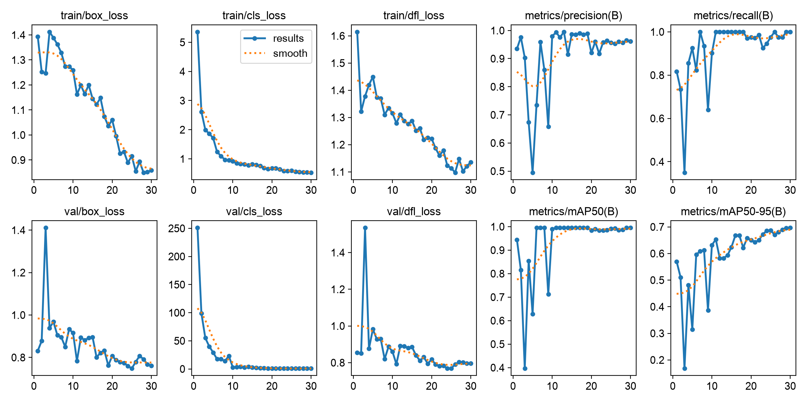
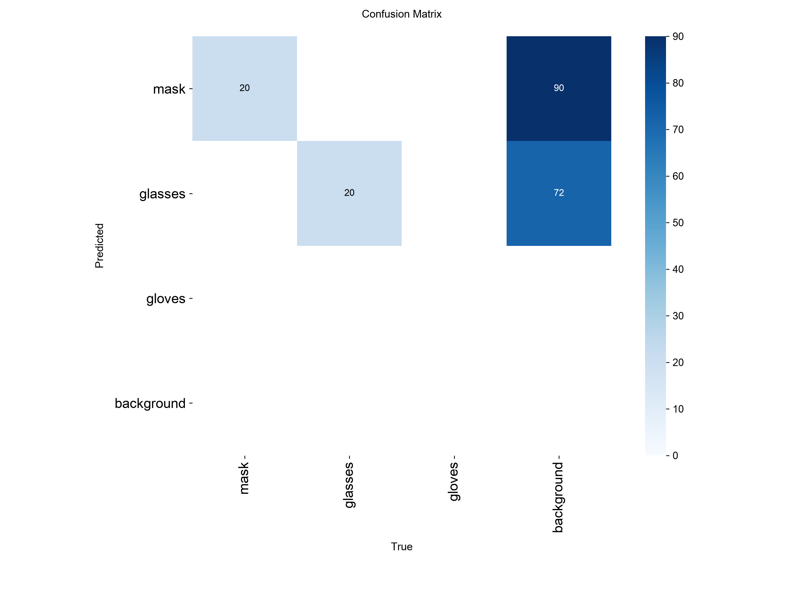
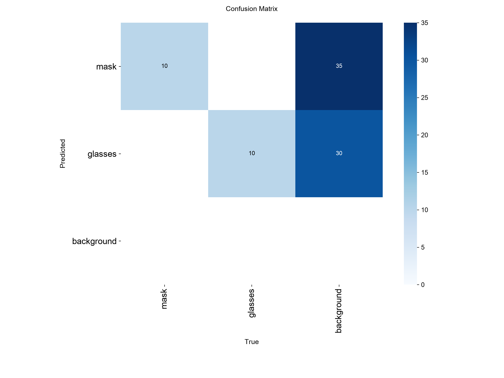
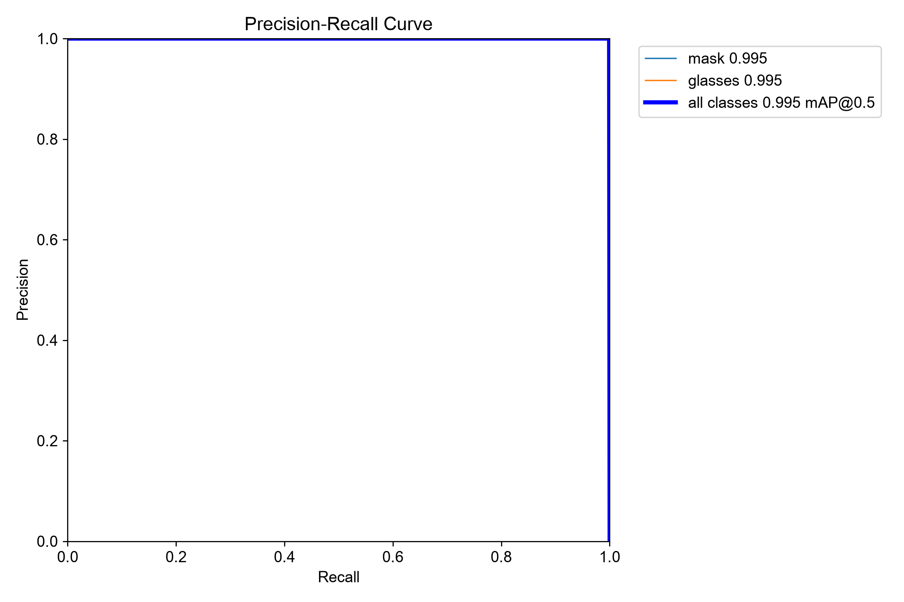
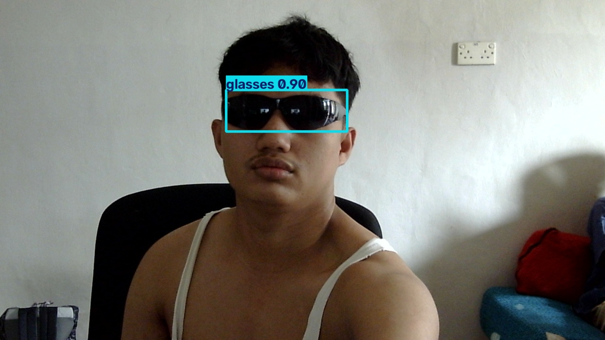

# PJ1 — Computer Vision and Deep Learning (RET503)

**Proyek:** Deteksi Alat Pelindung Diri (APD) menggunakan YOLO11n

Repository ini berisi implementasi, dataset, eksperimen, evaluasi, dan dokumentasi Project 1 mata kuliah Computer Vision and Deep Learning (RET503).

## 1. Deskripsi Proyek

Proyek ini mengimplementasikan deteksi objek menggunakan YOLO11n untuk mengenali penggunaan Alat Pelindung Diri (APD) pada gambar dan video webcam.

Tujuan proyek:
- Menyiapkan dataset dan anotasi untuk deteksi objek.
- Melatih model YOLO11n menggunakan dataset yang disiapkan.
- Mengevaluasi performa model pada data validation dan testing.
- Menguji model pada gambar dan webcam.
- Mendokumentasikan proses eksperimen dan hasil evaluasi.

### Kelas objek

- `mask` — masker.
- `glasses` — kacamata.

**Catatan:** Dataset yang digunakan saat ini memiliki anotasi untuk masker dan kacamata. Deteksi sarung tangan belum dapat dinyatakan berhasil karena belum tersedia anotasi objek sarung tangan yang terverifikasi.

## 2. Teknologi

| Komponen | Teknologi |
|---|---|
| Bahasa pemrograman | Python |
| Model deteksi | YOLO11n |
| Framework | Ultralytics |
| Deep learning | PyTorch |
| Computer vision | OpenCV |
| Editor | Visual Studio Code |
| Version control | Git dan GitHub |

## 3. Struktur Repository

```text
PJ1-Computer-Vision-and-Deep-Learning-RET503/
├── dataset/
│   ├── images/
│   │   ├── train/
│   │   ├── val/
│   │   └── test/
│   ├── labels/
│   │   ├── train/
│   │   ├── val/
│   │   └── test/
│   ├── data.yaml
│   └── dataset_stats.txt
├── kode/
│   ├── train.py
│   └── predict.py
├── dokumentasi/
│   ├── catatan.md
│   ├── hasil_eksperimen.md
│   └── gambar_hasil/
│       ├── grafik_training.png
│       ├── confusion_matrix_training.png
│       ├── confusion_matrix_test.png
│       ├── pr_curve_test.png
│       └── kacamata_saja_20261025_104852_024_0045.jpg
├── hasil/
├── .gitignore
├── requirements.txt
└── README.md
```

## 4. Dataset

Dataset terdiri dari 200 gambar dengan pembagian berikut.

| Subset | Jumlah gambar |
|---|---:|
| Training | 140 |
| Validation | 40 |
| Testing | 20 |
| **Total** | **200** |

Dataset menggunakan format anotasi YOLO berupa bounding box dan class ID.

Sumber dataset: [Aidilrajinbelajar/PJ1-RET-503](https://github.com/Aidilrajinbelajar/PJ1-RET-503), khususnya direktori `data_projek/dataset_sendiri`.

Dataset digunakan untuk eksperimen proyek ini dengan mencantumkan sumber aslinya.

## 5. Konfigurasi Training

| Parameter | Nilai |
|---|---|
| Model | YOLO11n |
| Epoch | 30 |
| Image size | 640 × 640 |
| Batch size | 8 |
| Perangkat | CPU |
| Jumlah gambar | 200 |

Bobot model hasil training:

`hasil/ppe_k3-3/weights/best.pt`

Bobot model disimpan secara lokal dan tidak disertakan dalam repository. Grafik dan hasil evaluasi terpilih tersedia pada folder dokumentasi.

## 6. Hasil Evaluasi Data Testing

Evaluasi dilakukan pada 20 gambar testing yang terdiri dari 20 instance objek beranotasi.

| Metrik | Hasil |
|---|---:|
| Precision | 0.967 |
| Recall | 1.000 |
| mAP@50 | 0.995 |
| mAP@50–95 | 0.807 |
| Waktu inferensi rata-rata | 38.5 ms/gambar |

Hasil per kelas:

| Kelas | Precision | Recall | mAP@50 | mAP@50–95 |
|---|---:|---:|---:|---:|
| Mask | 0.960 | 1.000 | 0.995 | 0.833 |
| Glasses | 0.974 | 1.000 | 0.995 | 0.780 |
| **Keseluruhan** | **0.967** | **1.000** | **0.995** | **0.807** |

Hasil tersebut menunjukkan performa yang baik pada dataset testing yang digunakan. Namun, ukuran dataset yang terbatas berarti evaluasi tambahan pada data yang lebih beragam tetap diperlukan.

## 7. Visualisasi Hasil Eksperimen

### 7.1 Grafik Training



Grafik memperlihatkan perkembangan metrik training dan validation selama proses pelatihan.

### 7.2 Confusion Matrix Training



Confusion matrix digunakan untuk mengamati hasil klasifikasi objek pada evaluasi training/validation.

### 7.3 Confusion Matrix Testing



Confusion matrix testing digunakan untuk melihat hasil prediksi model terhadap data pengujian.

### 7.4 Precision–Recall Curve



Kurva Precision–Recall menggambarkan hubungan precision dan recall pada berbagai nilai confidence threshold.

### 7.5 Contoh Prediksi pada Gambar



Gambar di atas merupakan contoh hasil prediksi model pada gambar pengujian.

## 8. Instalasi

Jalankan perintah berikut melalui terminal pada direktori utama repository.

```powershell
python -m venv .venv
.\.venv\Scripts\Activate.ps1
python -m pip install -r requirements.txt
```

## 9. Menjalankan Training

```powershell
python .\kode\train.py --model yolo11n.pt --epochs 30 --imgsz 640 --batch 8
```

Perintah tersebut menjalankan training menggunakan model YOLO11n dengan 30 epoch, ukuran gambar 640, dan batch size 8.

## 10. Prediksi Gambar

Contoh menjalankan prediksi pada satu gambar:

```powershell
python .\kode\predict.py --source ".\dataset\images\test\kacamata_saja_20261025_104852_024_0045.jpg"
```

Program memuat model hasil training, menjalankan deteksi, dan menyimpan hasil prediksi.

## 11. Prediksi Webcam

Untuk menjalankan deteksi secara langsung menggunakan webcam:

```powershell
python .\kode\predict.py --source 0
```

Angka `0` menunjukkan kamera default. Tekan tombol `Q` pada jendela prediksi untuk menghentikan proses jika didukung; jika tidak, hentikan proses melalui terminal.

## 12. Keterbatasan

- Dataset terdiri dari 200 gambar sehingga belum mencakup seluruh variasi kondisi lapangan.
- Training dilakukan menggunakan CPU.
- Anotasi yang tersedia berfokus pada masker dan kacamata.
- Model belum dapat dinyatakan mampu mendeteksi sarung tangan karena belum tersedia anotasi kelas tersebut yang terverifikasi.
- Performa pada kondisi pencahayaan, sudut pandang, jarak, dan lingkungan yang berbeda perlu diuji lebih lanjut.

## 13. Dokumentasi Tambahan

Dokumentasi eksperimen dan catatan pengerjaan tersedia di:

- [`dokumentasi/catatan.md`](dokumentasi/catatan.md)
- [`dokumentasi/hasil_eksperimen.md`](dokumentasi/hasil_eksperimen.md)
- [`dokumentasi/gambar_hasil/`](dokumentasi/gambar_hasil/)

## 14. Status Pengerjaan

Pengerjaan yang telah dilakukan meliputi persiapan dataset, konfigurasi YOLO11n, training selama 30 epoch, evaluasi pada data testing, prediksi gambar, dan pengujian menggunakan webcam.

---

**Mata kuliah:** Computer Vision and Deep Learning (RET503)  
**Proyek:** Project 1 — Deteksi APD  
**Repository:** [PJ1-Computer-Vision-and-Deep-Learning-RET503](https://github.com/rachmatcahyo1818-bit/PJ1-Computer-Vision-and-Deep-Learning-RET503)
