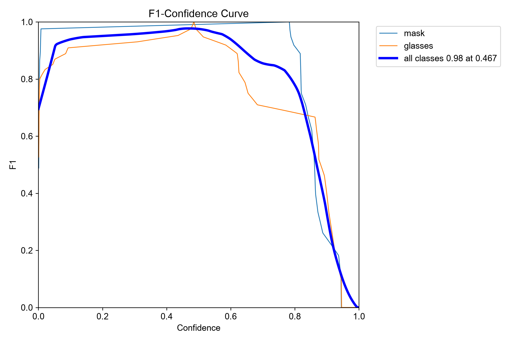
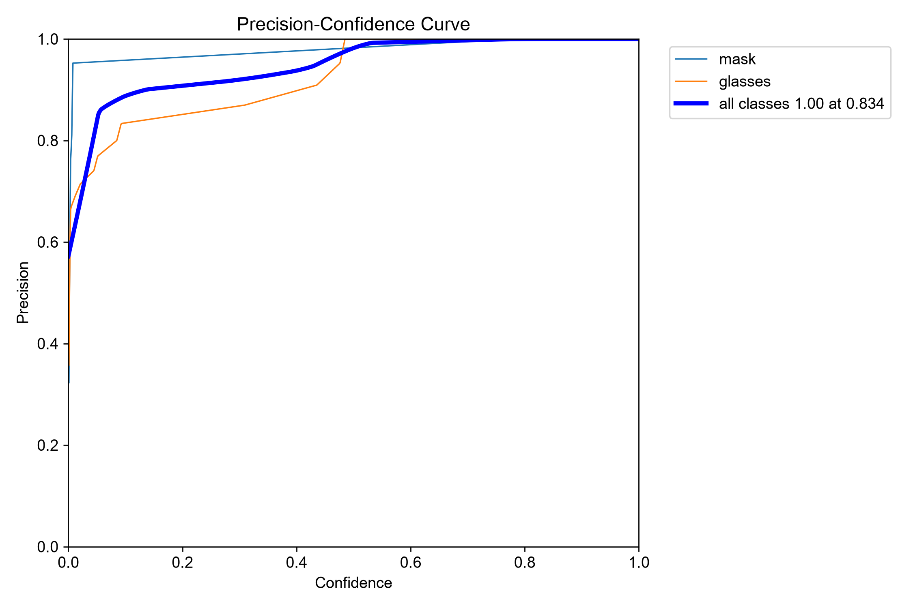
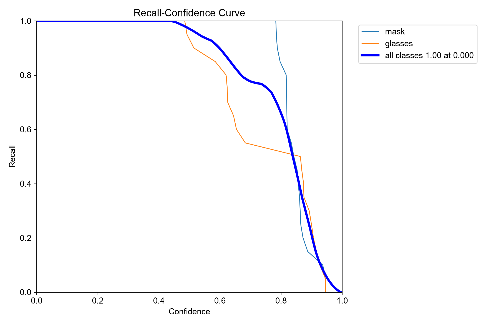
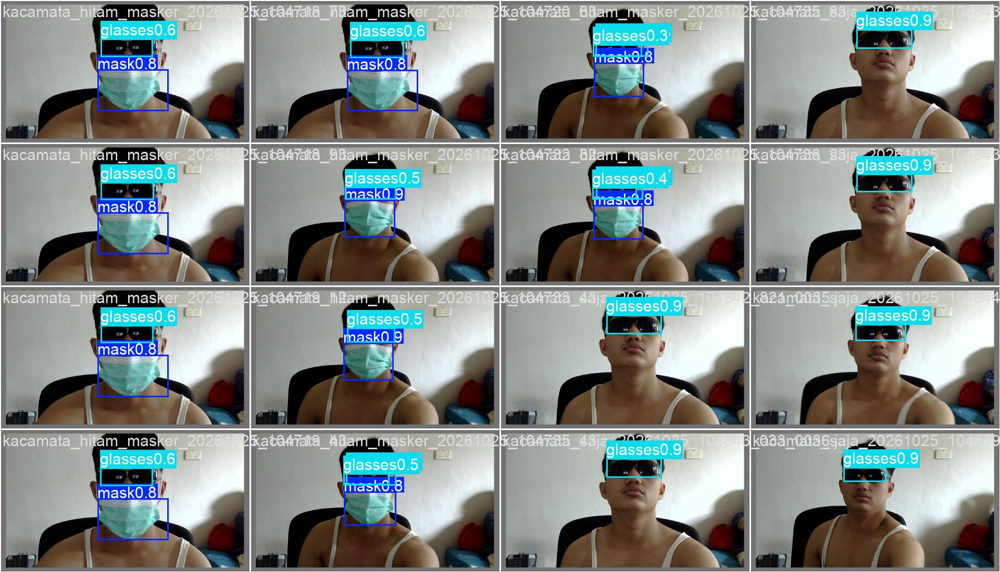
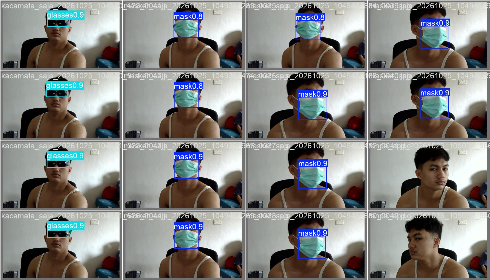
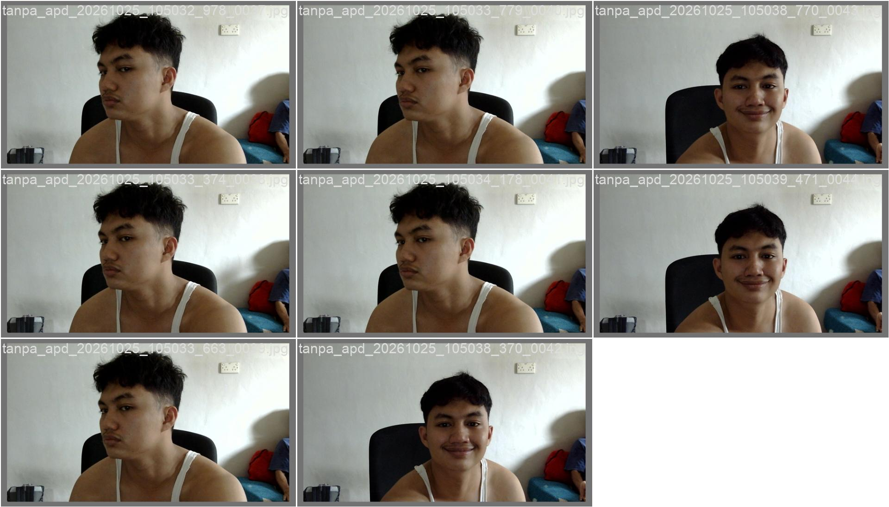

# Laporan Eksperimen Deteksi APD Menggunakan YOLO11n

## 1. Tujuan

Eksperimen ini bertujuan melatih dan mengevaluasi model deteksi objek untuk mengenali dua jenis alat pelindung diri (APD), yaitu masker (*mask*) dan kacamata (*glasses*), menggunakan YOLO11n.

## 2. Dataset

Dataset terdiri dari 200 gambar yang dibagi menjadi data training, validation, dan testing.

| Subset | Jumlah Gambar |
|---|---:|
| Training | 140 |
| Validation | 40 |
| Testing | 20 |
| **Total** | **200** |

Kelas objek yang digunakan:

- Class 0: Mask
- Class 1: Glasses

Dataset referensi: [Aidilrajinbelajar/PJ1-RET-503](https://github.com/Aidilrajinbelajar/PJ1-RET-503).

**Catatan:** Kelas gloves tidak disertakan karena anotasinya belum terverifikasi pada dataset yang digunakan.

## 3. Konfigurasi Training

| Parameter | Nilai |
|---|---|
| Model | YOLO11n |
| Bobot awal | `yolo11n.pt` |
| Epoch | 30 |
| Ukuran gambar | 640 × 640 piksel |
| Batch size | 8 |
| Perangkat | CPU |
| Framework | Ultralytics |
| Jumlah kelas | 2 |

## 4. Hasil Validasi

Hasil validasi model terbaik setelah training:

| Metrik | Hasil |
|---|---:|
| Precision | 96,2% |
| Recall | 100% |
| mAP@50 | 99,5% |
| mAP@50–95 | 69,7% |
| Waktu inferensi rata-rata | 38,8 ms/gambar |

## 5. Hasil Evaluasi Testing

Model terbaik kemudian dievaluasi menggunakan 20 gambar testing.

| Kelas | Jumlah Instance | Precision | Recall | mAP@50 | mAP@50–95 |
|---|---:|---:|---:|---:|---:|
| Mask | 10 | 97,3% | 100% | 99,5% | 81,2% |
| Glasses | 10 | 100% | 96,2% | 99,5% | 75,2% |
| **Keseluruhan** | **20** | **98,7%** | **98,1%** | **99,5%** | **78,2%** |

Waktu inferensi rata-rata pada evaluasi testing adalah 43,0 ms per gambar, belum termasuk preprocessing dan postprocessing.

## 6. Visualisasi Hasil Eksperimen

### 6.1 Grafik Training

### 6.2 Confusion Matrix Training/Validation

### 6.3 Confusion Matrix Testing

### 6.4 Precision–Recall Curve Testing

### 6.5 F1 Curve

### 6.6 Precision Curve

### 6.7 Recall Curve

### 6.8 Contoh Prediksi Data Validation

## 7. Analisis Hasil

Pada dataset testing, model memperoleh precision sebesar 98,7%, recall sebesar 98,1%, dan mAP@50 sebesar 99,5%. Hasil ini menunjukkan bahwa model dapat mendeteksi dua kelas yang digunakan dengan baik pada data pengujian tersebut.

Nilai mAP@50–95 sebesar 78,2% lebih rendah daripada mAP@50. Hal ini menunjukkan bahwa ketepatan posisi bounding box masih dapat ditingkatkan ketika digunakan kriteria Intersection over Union (IoU) yang lebih ketat.

Hasil evaluasi ini berlaku untuk dataset pengujian yang digunakan dan belum menjamin performa yang sama pada seluruh kondisi lingkungan nyata.

## 8. Keterbatasan

1. Dataset terdiri dari 200 gambar sehingga variasi data masih terbatas.
2. Model hanya mendeteksi masker dan kacamata.
3. Kelas gloves belum dimasukkan karena anotasinya belum terverifikasi.
4. Training dilakukan menggunakan CPU.
5. Pengujian tambahan diperlukan pada variasi pencahayaan, jarak, sudut pengambilan gambar, dan kondisi lingkungan nyata.

## 9. Kesimpulan

Model YOLO11n berhasil dilatih selama 30 epoch untuk mendeteksi masker dan kacamata. Pada 20 gambar testing, model memperoleh precision 98,7%, recall 98,1%, mAP@50 99,5%, dan mAP@50–95 78,2%.

Model ini dapat digunakan sebagai prototipe deteksi dua kelas APD. Pengembangan selanjutnya dapat dilakukan dengan menambah variasi dataset, memverifikasi anotasi, dan menguji model pada kondisi nyata.

## 10. Artefak Eksperimen

- `hasil_eksperimen.csv`: log metrik training setiap epoch.
- `konfigurasi_training.yaml`: konfigurasi training.
- `gambar_hasil/`: visualisasi training, evaluasi, dan contoh prediksi.
- `hasil/ppe_2kelas/weights/best.pt`: bobot model terbaik yang disimpan secara lokal.
